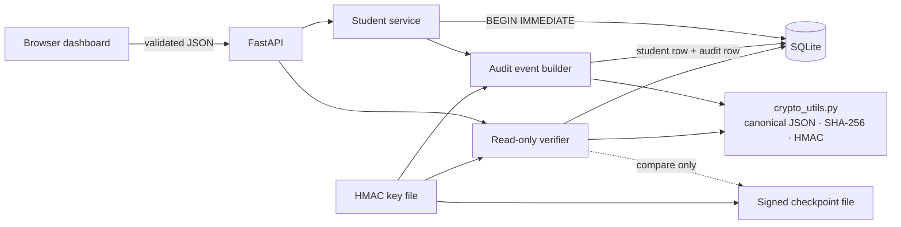
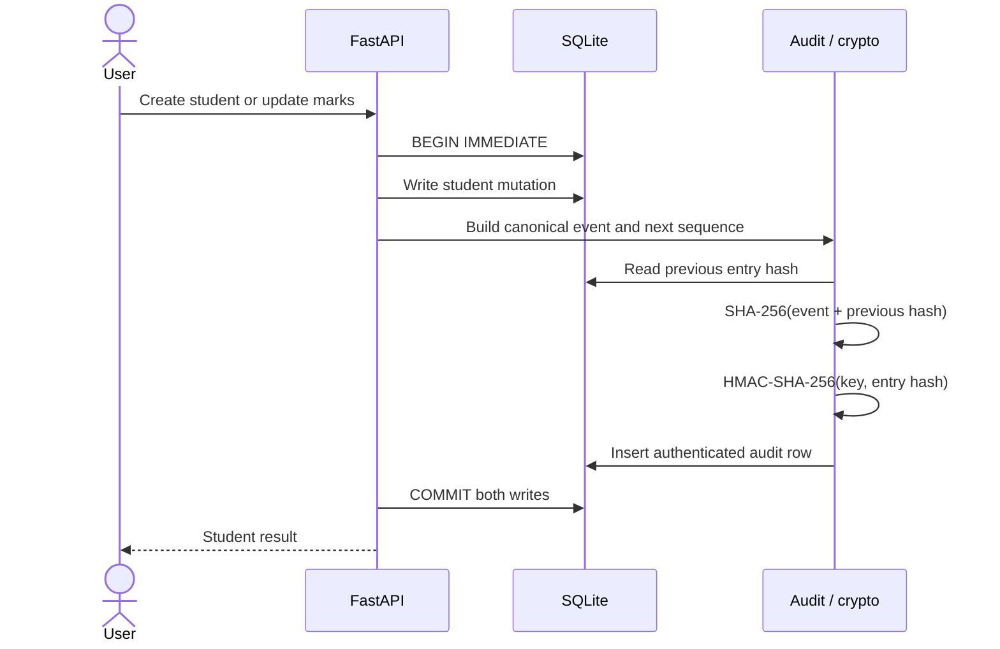

# Cryptography Audit Logs

**A local student-record application that demonstrates how to detect changes to a sensitive data history.** Student creation and marks updates are written to SQLite together with a cryptographically authenticated audit event. A polished browser dashboard shows student records, event history, verification results, and checkpoint status.

This is a college project and local security demonstration. It is not blockchain and it is not production-ready.

## Problem and motivation

A normal application log is useful for troubleshooting, but a person who can edit its database can also silently edit or remove the log. This project demonstrates how canonical event data, a SHA-256 hash chain, HMAC-SHA-256, and an independently retained checkpoint make different classes of changes detectable under stated trust assumptions.

## Features

- Add, list, and view students; update marks from 0 to 100.
- Prevent duplicate student IDs and reject invalid names, IDs, and marks.
- Record actor label, UTC timestamp, action, record ID, before/after values, event ID, sequence, previous hash, entry hash, and HMAC.
- Atomically commit each student mutation and its audit entry in one SQLite transaction.
- Verify event hashes, links, ordering/sequence, HMAC tags, and an optional signed checkpoint.
- Show a structured integrity report with first failure category, explanation, valid sequence, and expected/observed chain information.
- Create an isolated, repeatable demo run with its own database, key, checkpoint, and clean restore copy.
- Keep the demo-only tamper endpoint disabled by default, loopback-only, and restricted to a marked demo run with a separate key.

## Technology and project layout

Python, FastAPI, Uvicorn, SQLite, Pydantic, `hashlib`, `hmac`, plain HTML/CSS/JavaScript, and pytest. No frontend framework, cloud service, or database server is required.

```text
backend/
  main.py          FastAPI routes, safe demo gate, and app lifecycle
  models.py        Pydantic input validation
  database.py      Existing SQLite schema and transaction helper
  audit.py         Student mutations, event chain, and structured verifier
  crypto_utils.py  Canonical JSON, SHA-256, and HMAC single source of truth
  checkpoint.py    Explicit signed checkpoint CLI and comparison
  demo.py          Isolated prepare / verify / tamper / restore workflow
  config.py        Key and path configuration; never creates keys on startup
  generate_key.py  Explicit overwrite-safe 256-bit key generation
  static/          Responsive HTML, CSS, and JavaScript dashboard
tests/             Temporary database and test-key coverage
data/               Existing local database (ignored by Git; preserved)
.secrets/           Existing HMAC key and optional checkpoint (ignored by Git)
```

### Architecture



### Mutation sequence



## Cryptographic workflow

A new event includes:

```json
{
  "event_id": "audit-4",
  "sequence": 4,
  "timestamp": "2026-10-19T10:15:30+00:00",
  "actor": "faculty-user",
  "action": "marks_updated",
  "record_id": 1,
  "before": {"marks": 85},
  "after": {"marks": 95}
}
```

The event ID uses the existing unique SQLite audit-row ID. It is included in new event hashes. Existing pre-upgrade rows are verified using their original authenticated fields as a legacy format; the database is not automatically migrated or rewritten.

`backend.crypto_utils.canonical_json` uses sorted object keys, compact separators, UTF-8 characters, and rejects non-finite numbers. Its UTF-8 bytes are therefore stable for the same event. For each event:

```text
entry_hash = SHA256(canonical_json({"event": event, "previous_hash": previous_hash}))
hmac       = HMAC-SHA-256(secret_key, UTF8(entry_hash_hex))
```

The first event links to 64 zeroes. Every later event links to the preceding entry hash. The event hash excludes its own hash and HMAC. Verification independently recomputes the event hash and checks the stored HMAC using constant-time comparison. Hashes and HMACs do not encrypt or hide student data.

### What verification distinguishes

Each issue has a category such as `hash_mismatch`, `link_mismatch`, `hmac_invalid`, `sequence_gap`, `invalid_event`, `checkpoint_truncation`, or `checkpoint_mismatch`. The result reports the checked count, last valid sequence, first failure, explanation, observed tip, and checkpoint comparison. An empty log returns status `empty` and explains that there was no history to verify; it is not presented as a populated log that passed.

Run verification from the dashboard's **Verify integrity** action or request `GET /api/audit/verify`. It is read-only and does not create or advance a checkpoint. Each item in `issues` retains its compatibility `category` and includes a stable `code`, the failed `check`, a human-readable `message`, and the event `sequence` and `event_id` when available. Checkpoint findings identify `target: "trusted_checkpoint"` and distinguish authentication errors from anchor mismatch or truncation. `first_failure` is the first item in `issues`; `issues` contains additional findings in deterministic order.

After a verification run, select **Download Verification Report** in the dashboard to download a fresh JSON report. The download endpoint runs the same read-only verifier again, so the report reflects the database and checkpoint at download time rather than cached dashboard data. `GET /api/audit/verify/report` returns `verity-verification-report.json`; it does not persist a report file.

The report retains the verification response fields (`valid`, `status`, `entries_checked`, `last_valid_sequence`, `first_failure`, `issues`, `checkpoint`, and `verification_summary`) and adds `report_format`, `report_version`, `generated_at_utc`, `verification_outcome`, `checks_performed`, and `limitations`. Each ordered issue carries the diagnostic `code`, failed `check`, message, and event sequence/ID when available. `checks_performed` summarizes chain checks and checkpoint status. Outcomes are `verified` when the chain passes and the checkpoint matches, `verified_with_limits` when the chain passes without a matching trusted checkpoint, `failed` when any check fails, and `incomplete` for an empty history. A clean chain without a valid trusted checkpoint cannot establish that a prior tail was not truncated or rolled back. Even a matching checkpoint only anchors its sequence; later entries remain vulnerable to tail removal until a later checkpoint is explicitly created. The report does not include the HMAC key or filesystem paths.

The response also includes `verification_summary`: the number of rows read, the length of the contiguous fully verified prefix, per-check `passed`/`failed`/`not_checked` states, and checkpoint status. Rows after the first invalid event are still checked for additional findings, but are not counted in the trusted prefix. The dashboard displays the finding location, check, code, and reason. An empty log is reported as `empty`, not as a populated log that passed.

Event schema checks use fields and constraints from the existing writer and SQLite schema: positive integer IDs/sequences, parseable ISO timestamps, non-empty actor labels, supported actions, positive record IDs, JSON object/null before values and object after values, and action-specific student/marks fields and ranges. The verifier also accepts the repository's legacy authenticated event representation without `event_id`; it does not migrate or rewrite it. Malformed JSON is reported separately, and its event hash is marked `not_checked` because there is no parsed event to hash.

Diagnostic codes include `entry_hash_mismatch`, `hmac_verification_failed`, `previous_hash_mismatch`, `sequence_gap`, `malformed_json`, `invalid_event_schema`, `checkpoint_signature_invalid`, `checkpoint_truncation`, and `checkpoint_mismatch`. Hashes may be included as expected/observed context, but the HMAC key is never returned.

| Attack or condition | Detection |
|---|---|
| Change an authenticated event field | Recomputed SHA-256 differs |
| Change the stored entry hash | Hash and usually HMAC checks fail; following links can also fail |
| Change a previous-hash link | Link check fails and the event hash no longer matches |
| Change an HMAC or verify with the wrong key | HMAC-SHA-256 check fails independently |
| Delete an interior event or change sequence order | Sequence continuity and/or link checks fail |
| Remove latest events after a trusted checkpoint | Checkpoint tip is missing or no longer matches |
| Remove the latest events without a checkpoint | A valid prefix remains; the app cannot infer that a later tail existed |

## Key management

The 256-bit key is hex encoded in `.secrets/hmac.key`, outside SQLite and ignored by Git. Startup reads but never generates or replaces a key. A missing or invalid key causes startup to fail before database initialization. If a database already has history, restore its original key from backup; a newly generated key will not authenticate that history. Generate a key only for a new empty database. The explicit generator refuses to overwrite any existing destination.

```powershell
python -m backend.generate_key
```

If a key is lost, stored HMACs cannot be verified with a replacement key. Restore the original key from a protected backup. If the key is compromised, an attacker with database access may create valid HMACs for rewritten history; treat the history as untrusted, rotate the key through a planned migration, and preserve evidence. This project does not implement key rotation.

The application also accepts `AUDIT_HMAC_KEY` as a 64-character hex value, with precedence over the key file. Avoid placing a real value in a committed file or shell transcript. Keep the key and checkpoint backups access-restricted.

## Trusted checkpoints

A checkpoint is a separate JSON file (default `.secrets/audit_checkpoint.json`) containing the last explicitly trusted sequence, chain hash, timestamp, version, and an HMAC made with the configured key. Ordinary verification only reads it. It never advances it.

After inspecting a valid history, create an initial checkpoint:

```powershell
python -m backend.checkpoint create
```

After additional changes have been reviewed and verified, explicitly advance it:

```powershell
python -m backend.checkpoint update
```

The command refuses to checkpoint an invalid chain, overwrite an invalid checkpoint, move the trusted sequence backwards, or change the hash at the same sequence. When a checkpoint exists, verification compares its anchor with the database and reports truncation or mismatch. The database is not initialized or altered by the checkpoint command if its file is missing.

The checkpoint must be protected independently from the database, ideally copied to a separately controlled location. By default the file sits beside the local key, separate from SQLite but still on the same machine. An attacker who can replace both database and checkpoint and access the HMAC key can defeat this local scheme. Removing the checkpoint file is visible as `not_created`, but no local program can prove a checkpoint once existed if every independent reference to it is also removed. This is why external backup/checkpoint custody matters.

Override paths when needed:

```powershell
$env:AUDIT_DB_PATH = "data/audit_logs.sqlite3"
$env:AUDIT_HMAC_KEY_FILE = ".secrets/hmac.key"
$env:AUDIT_CHECKPOINT_FILE = ".secrets/audit_checkpoint.json"
```

## Windows setup and startup

From `C:\Projects\cryptography_audit_logs`, use the existing virtual environment when available. For a clean setup with Python 3.12:

```powershell
if (-not (Test-Path .venv\Scripts\python.exe)) { py -3.12 -m venv .venv }
.\.venv\Scripts\Activate.ps1
python -m pip install -r requirements.txt
```

This workspace already has a key and database. Keep both; do not regenerate or replace the key. For a brand-new installation only, the guarded command below creates a key when neither a key nor an existing database is present. If the database exists but the key is missing, stop and restore the matching key backup:

```powershell
if (Test-Path .secrets\hmac.key) { Write-Output "Existing HMAC key retained." }
elseif (Test-Path data\audit_logs.sqlite3) { throw "Database exists but its key is missing. Restore the original key backup; do not generate a replacement." }
else { python -m backend.generate_key }
```

Start the local application:

```powershell
python -m uvicorn backend.main:app --host 127.0.0.1 --port 8000 --reload
```

Open **http://127.0.0.1:8000**. OpenAPI documentation is available at `/docs`. Keep this classroom app bound to loopback; it does not authenticate users.

## Safe professor demonstration

The commands below use a newly created directory under `.demo_runs/`, with a fresh demo key, database, signed checkpoint, marker, and clean database baseline. They do not reset or use `data/audit_logs.sqlite3` or `.secrets/hmac.key`. Every `prepare` creates a new uniquely named run rather than overwriting an earlier run.

### 1. Prepare data and see the first verification

```powershell
python -m backend.demo prepare
```

Copy the run path and PowerShell environment commands printed by `prepare`. They point Uvicorn at that isolated database/key/checkpoint and set the tamper gate for the marked run. Start the server and open the browser URL printed by the command (`http://127.0.0.1:8000`). The dashboard will show two students and the `85 → 95` update, plus a matching checkpoint.

### 2. Demonstrate a controlled integrity failure

Use the dashboard's **Development only** tamper panel, or stop the server and use the explicit CLI command (replace the placeholder with the printed run path):

```powershell
python -m backend.demo tamper --run-dir "<printed .demo_runs run path>" --sequence 1
```

Verification reports the exact event/hash failure. Since this demo edits event data but leaves stored chain hashes alone, the checkpoint can still match the stored tip; the event hash check is what catches this edit. The CLI exits with code 0 when it successfully demonstrates a failed verification.

To demonstrate trusted-tail truncation separately, restore first, then remove only the latest checkpointed event:

```powershell
python -m backend.demo restore --run-dir "<printed .demo_runs run path>"
python -m backend.demo truncate --run-dir "<printed .demo_runs run path>"
```

This CLI operation is restricted to the marked demo folder and removes the checkpoint's own final row; verification reports `checkpoint_truncation`. There is no truncation API endpoint.

### 3. Restore and verify successfully

Stop Uvicorn before restoring the demo files, then run:

```powershell
python -m backend.demo restore --run-dir "<printed .demo_runs run path>"
python -m backend.demo verify --run-dir "<printed .demo_runs run path>"
```

Restore copies the clean baseline only over the validated database path inside that marked disposable run. It preserves the demo key and matching checkpoint. Successful verification returns exit code 0. No command in this workflow resets the normal development database.

After the presentation, clear the demo overrides in that PowerShell session before starting the normal local database again:

```powershell
Remove-Item Env:AUDIT_DB_PATH,Env:AUDIT_HMAC_KEY_FILE,Env:AUDIT_CHECKPOINT_FILE,Env:AUDIT_DEMO_ROOT,Env:AUDIT_DEMO_TAMPERING,Env:AUDIT_HMAC_KEY -ErrorAction SilentlyContinue
```

The ordinary API tamper endpoint requires all of: explicit `AUDIT_DEMO_TAMPERING=true`, a loopback client, a database inside `AUDIT_DEMO_ROOT`, a valid disposable-demo marker, and the corresponding separate demo key. It is unavailable against the default database even if the flag is set.

The CLI and API share demo path checks. API startup detects marked runs by canonical/resolved path and file identity, so a symlink/junction or hard-link alias cannot silently make a marked demo database look like an ordinary database. Aliased database paths are rejected; use the canonical path printed by `prepare`. Demo DB connections reject database or SQLite sidecar files (`-journal`, `-wal`, `-shm`) that are not ordinary single-link files, checking before and after connection setup and at transaction boundaries. Existing regular sidecars are preserved and left for SQLite's normal recovery; the application does not delete them or change journal mode. Demo restore refuses to replace a database while any SQLite sidecar exists. If recovery artifacts exist, stop database users and preserve/recover those files before attempting restore.

These checks protect against pre-existing path escapes and static hard links. Python's SQLite API opens a database by pathname, so a hostile process with write access to the demo directory could still race replacement of the database or a sidecar between checks and SQLite's file operation; the demo directory is not a security boundary against a concurrent attacker running as the same user. The application fails closed when an unsafe state is observed, but does not claim a race-free guarantee. Use a private local demo directory and do not run the demo while an untrusted process can write there.

Demo restore uses a unique, exclusively created staging file, validates its identity, then atomically replaces the database with `os.replace`. This prevents following a pre-existing staging symlink or hard link and avoids exposing a partially copied database. Portable pathname checks cannot make the final validation-to-replacement interval race-free: a concurrent process able to modify the run directory could substitute a path entry after validation. Stop the application and keep the demo directory private while restoring; this workflow is intended for a controlled local demonstration, not protection from a same-user concurrent attacker.

## API

| Method | Endpoint | Purpose |
|---|---|---|
| `GET` | `/api/students` | List student records |
| `GET` | `/api/students/{id}` | Read one student |
| `POST` | `/api/students` | Create student plus audit entry (`201`; duplicate ID `409`) |
| `PATCH` | `/api/students/{id}/marks` | Change marks, 0–100, plus audit entry |
| `GET` | `/api/audit?limit=200` | Read newest audit entries with event ID, hashes, and values |
| `GET` | `/api/audit/verify` | Read-only structured chain, HMAC, and checkpoint verification |
| `GET` | `/api/audit/verify/report` | Fresh JSON verification report as a fixed-name download |
| `GET` | `/api/status` | Report whether the demo control is configured |
| `POST` | `/api/demo/tamper` | Explicit local demo only, marked isolated database only |

Example create/update requests:

```powershell
Invoke-RestMethod http://127.0.0.1:8000/api/students -Method Post `
  -ContentType 'application/json' `
  -Body '{"name":"Asha Rao","student_number":"CS-2026-014","marks":85}'

Invoke-RestMethod http://127.0.0.1:8000/api/students/1/marks -Method Patch `
  -ContentType 'application/json' -Body '{"marks":95}'

Invoke-RestMethod http://127.0.0.1:8000/api/audit/verify
```

`X-Actor` is recorded for attribution; the dashboard uses `faculty-user`. It is caller-supplied, not authenticated identity.

### Audit history search

`GET /api/audit` keeps returning the original JSON array of event objects, newest sequence first, with deterministic sequence/row-ID ordering. It now supports database-side filters for the fields present in the audit schema:

- `action`: `student_created` or `marks_updated`.
- `actor`: exact actor-label match.
- `event_id`: exact generated ID such as `audit-12` (derived from the audit row ID).
- `record_id`: positive student record ID.
- `sequence_from` and `sequence_to`: inclusive positive sequence bounds.
- `start_at` and `end_at`: inclusive ISO 8601 timestamps with a UTC offset; timestamps are compared as SQLite dates, including offset normalization.
- `limit` and `offset`: page size from 1 to 500 (default 200) and zero-based offset (maximum 100000).

All filter values are bound SQL parameters. Invalid actions, IDs, ranges, timestamps, limits, or offsets return HTTP 422. The response remains an array for compatibility; `X-Total-Count` gives the number of matching rows before pagination. No filters returns the same newest-first listing as before. Searching only reads audit rows and does not run verification, modify entries, or advance a checkpoint. The dashboard displays the matching count and provides paging. A filter changes only the visible rows; **Verify integrity** continues to check the complete audit history, and filtering does not refresh or change the verification status.

Examples:

```text
GET /api/audit?action=marks_updated&actor=faculty-user
GET /api/audit?sequence_from=20&sequence_to=40&limit=10&offset=0
GET /api/audit?event_id=audit-12
GET /api/audit?start_at=2026-10-20T00%3A00%3A00Z&end_at=2026-10-20T23%3A59%3A59Z
```

The current event schema has no category field or full-text search index, so category/text search is not provided. Actor filtering is exact rather than a partial substring search. Pagination is offset-based, which is suitable for the classroom-sized register; large production histories would need a separately designed cursor/pagination strategy.

## Transactions and concurrency

Each mutation obtains a SQLite `BEGIN IMMEDIATE` write transaction before reading the last sequence, so concurrent writers serialize. Sequence numbers are unique in the database. Student change and audit insert commit together; any exception rolls back both. The hash-chain order and sequence are checked again during verification.

## Threat model and limitations

The project detects event edits, broken links, bad HMACs, sequence gaps/reordering, and truncation relative to a trusted checkpoint. It does not make the database append-only at the storage layer.

- An attacker who can rewrite the entire database but does not have the HMAC key cannot normally produce valid new HMACs.
- An attacker with both database and HMAC-key access may rewrite every event, recompute the chain and HMACs, and produce a valid replacement history.
- A checkpoint in the database directory would share the same failure domain; keep it in a separately protected location or backup. This project's default `.secrets` directory is separate from SQLite but still local.
- A checkpoint detects rollback/truncation only up to its signed sequence. Events appended after the last checkpoint are not protected against removal until a later explicit checkpoint is made.
- Actor labels are caller supplied. No authentication, authorization, encrypted database, rate limiting, immutable storage, key rotation, external trusted timestamp, or remote checkpoint service is implemented.
- Student data is stored in readable SQLite. SHA-256 and HMAC provide integrity/authentication checks, not confidentiality.
- SQLite is suitable for this local single-machine demonstration. Write transactions serialize, and verification reads the current audit history; performance and write throughput will become limiting as history grows. A real deployment would need measured pagination/retention design and independent storage controls.

## Testing and quality checks

The tests use per-test temporary databases and fixed test keys, never the development database or real key:

```powershell
python -m pytest -q --basetemp .pytest-results
python -m compileall -q backend tests
node --check backend\static\app.js
```

Coverage includes valid and empty histories, field/hash/link/HMAC tampering, wrong keys, event IDs and before/after values, reordering, interior deletion, checkpoint-based tail truncation, invalid checkpoints, non-advancing verification, missing-key startup configuration, atomic rollback, API validation, demo isolation, and restore.

## Beyond a plain application log

| Plain application log | This project adds |
|---|---|
| Readable event text | Deterministic canonical event representation |
| Events can be edited independently | Hash-linked ordered history detects edits and broken links |
| No keyed authenticity check | HMAC-SHA-256 verification using an external key |
| Latest tail deletion is silent | Explicit signed checkpoint detects truncation up to its trusted sequence |
| Manual risky demo edits | Repeatable isolated demo database, key, checkpoint, tamper, and restore commands |

## Future improvements

For a larger or real-world system, add authenticated identities and roles, independent/offline checkpoint custody, encrypted backups, key rotation and recovery, schema migration tooling, external timestamping, audit export/signatures, performance measurements, and stronger deployment controls. Each would require a separate threat-model and operational design.
